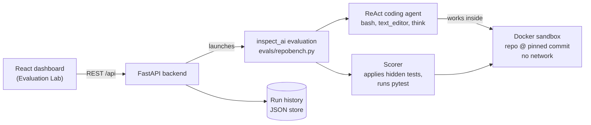

# RepoBench: Coding-Agent Evaluation Platform

**Measure whether an AI coding agent can actually fix real bugs in real codebases, and see exactly how it did it.**

RepoBench runs an AI agent against genuine bug reports from open-source repositories, inside an isolated sandbox, and grades the result with the project's own tests. A web dashboard ("Evaluation Lab") lets you launch runs, track pass/fail rates, and replay every command the agent executed.

[](LICENSE)


---

## Why this exists

Public leaderboards tell you how a model does on someone else's problems. If you are deciding whether to trust an AI agent with *your* codebase, you need evidence on tasks that look like your work, and you need to be able to audit the process, not just the score.

| If you are... | RepoBench gives you... |
| --- | --- |
| **A business owner or stakeholder** | A clear pass/fail rate per model and task, with a full audit trail behind every number. Evidence for build-vs-buy and vendor-comparison decisions. |
| **An engineering leader** | A repeatable, tamper-resistant way to compare models and agent setups on realistic bug-fix work before rolling them out to a team. |
| **A developer or researcher** | A small, readable harness built on [`inspect_ai`](https://inspect.aisi.org.uk/): add a task with one YAML file and a test patch, then inspect every tool call. |

---

## Key features

- **Real bugs, real repositories.** Each task is pinned to an actual upstream commit and derived from a real pull request.
- **Objective grading.** A run passes only if the hidden regression tests *and* the existing test suite pass. No LLM-as-judge, no subjective scoring.
- **Fair by design.** The grading tests never exist in the agent's environment. They are applied only after the agent submits, so the agent cannot read or game them.
- **Isolated and offline.** Every run happens in a Docker container with networking disabled, so the agent cannot look up the upstream fix.
- **Full transparency.** Replay each step of a run: the shell commands, file edits, reasoning notes, outputs, and timings.
- **Cheating is detected.** Editing the protected test files is an automatic failure.
- **Model-agnostic.** Any model supported by `inspect_ai` (Anthropic, OpenAI, and others) can be selected from the UI.
- **Simple to extend.** Adding a new task is one YAML file plus one patch file.

---

## How it works



**The lifecycle of one run:**

1. **Setup.** The sandbox checks out the task's pinned `base_commit` of the target repository.
2. **Agent loop.** The agent is shown only the bug title and description. It explores the code, edits files, and runs tests until it submits.
3. **Anti-tamper check.** The scorer verifies the agent did not modify any test file that the grading patch touches.
4. **Hidden tests.** The grading patch is applied, and the `fail_to_pass` tests (which must now pass) and `pass_to_pass` tests (which must not regress) are run.
5. **Verdict.** `PASS` only if every required test passes. Otherwise `FAIL`, with the explanation and test output retained.

---

## What you see in the dashboard

| Page | Purpose |
| --- | --- |
| **Dashboard** | Headline metrics: total runs, passed, failed, success rate, plus the most recent runs. |
| **New Run** | Pick a task, pick a model, set a step limit, and launch. |
| **Runs** | Full history, filterable by task, agent, and result. |
| **Run Details** | Step-by-step transcript. Select any step to see its arguments, output, duration, and status. The page refreshes live while a run is in progress. |

---

## Tech stack

| Layer | Technology |
| --- | --- |
| Evaluation engine | [`inspect_ai`](https://inspect.aisi.org.uk/) (ReAct agent, sandboxing, scoring) |
| Backend API | Python 3.13, FastAPI, Pydantic, Uvicorn |
| Sandbox | Docker / Docker Compose |
| Frontend | React 19, TypeScript, Vite, Tailwind CSS 4, React Router |
| Task format | YAML + unified-diff test patches |

---

## Quick start

### Prerequisites

- Python **3.13+** and [`uv`](https://docs.astral.sh/uv/) (or `pip`)
- Node.js **20.19+** (or 22.12+) and npm
- Docker (running)
- An API key for the model you want to evaluate, e.g. `ANTHROPIC_API_KEY`

### 1. Install dependencies

```bash
uv sync                      # Python dependencies
cd frontend && npm install   # Frontend dependencies
```

### 2. Clone the target repository (full history required)

```bash
git clone https://github.com/pydantic/pydantic-ai repos/pydantic-ai
```

> A shallow clone will not work: each task checks out its own pinned commit. See [`repos/README.md`](repos/README.md).

### 3. Build the sandbox image

```bash
docker compose -f sandbox/pydantic-ai/compose.yaml build
```

All dependencies are installed at build time, so the running sandbox needs no internet access.

### 4. Set credentials

```bash
export ANTHROPIC_API_KEY=your-key-here
```

### 5. Start the backend and frontend

```bash
# Terminal 1 (from the project root)
uv run uvicorn backend.main:app --reload --port 8000

# Terminal 2
cd frontend && npm run dev
```

Open **http://localhost:5173**, choose **New Run**, and launch your first evaluation.

### Prefer the command line?

The evaluation is a standard `inspect_ai` task, so you can skip the UI entirely:

```bash
inspect eval evals/repobench.py --model anthropic/claude-sonnet-4-6
inspect view     # browse results in inspect's own log viewer
```

---

## Included benchmark tasks

| ID | Repository | Difficulty | Summary |
| --- | --- | --- | --- |
| `task_001` | pydantic-ai | Easy | `RealtimeSession.send_audio` does not roll back user-turn state on a non-bytes chunk |
| `task_002` | pydantic-ai | Easy | `DeferredToolResults.approvals` silently accepts non-bool / non-approval values |

The set is intentionally small and easy to grow. See below.

---

## Adding a new task

1. Copy [`benchmark/tasks/TEMPLATE.yaml`](benchmark/tasks/TEMPLATE.yaml) to `benchmark/tasks/task_00N.yaml`.
2. Fill in the repository, pinned `base_commit`, a bug description, and the test IDs.
3. Add the test-only diff from the real fix to `benchmark/tasks/patches/task_00N.test.patch`.
4. Verify the `fail_to_pass` tests fail before the fix and pass after it.

Task files are validated strictly at load time, so malformed tasks fail loudly instead of producing a silently broken benchmark.

To evaluate a **new repository**, clone it into `repos/<name>`, add `sandbox/<name>/{Dockerfile,compose.yaml}`, and register it in `REPOSITORIES` in `benchmark/dataset.py`.

---

## Integrity and fairness safeguards

Credible evaluation depends on the agent not being able to shortcut the test. RepoBench enforces this structurally, not just by instruction:

| Risk | Safeguard |
| --- | --- |
| Agent reads the grading tests | They are applied only after submission and never copied into the sandbox. |
| Agent looks up the upstream fix online | The container runs with `network_mode: none`. |
| Agent edits tests to make them pass | The scorer fails the run if protected test files were modified. |
| Agent learns from grading feedback | Graded attempts default to **1**, so the agent never sees hidden-test output. |
| Hung or runaway commands | Per-command timeouts and a per-run message limit. |

---

## API reference

| Method | Path | Purpose |
| --- | --- | --- |
| `GET` | `/api/health` | Health check |
| `GET` | `/api/tasks` | Tasks from `benchmark/tasks/*.yaml` |
| `GET` | `/api/agents` | Models available in the UI |
| `GET` | `/api/runs` | Run history, newest first |
| `GET` | `/api/runs/{run_id}` | One run, including its transcript |
| `POST` | `/api/runs` | Start a run: `{taskId, agent, maxToolCalls}` |
| `GET` | `/api/dashboard/metrics` | Totals, pass/fail counts, success rate |

Interactive API docs are available at `http://localhost:8000/docs` while the backend is running.

---

## Configuration

| Variable | Default | Purpose |
| --- | --- | --- |
| `REPOBENCH_MODELS` | `anthropic/claude-sonnet-4-6` | Comma-separated `inspect_ai` model strings shown in the Agent dropdown |
| `REPOBENCH_CORS_ORIGINS` | `http://localhost:5173` | Comma-separated allowed origins for the API |
| `VITE_API_BASE_URL` | *(unset)* | Point a production frontend build at a remote backend |
| `VITE_API_PROXY_TARGET` | `http://localhost:8000` | Backend target for the Vite dev proxy |

Example, comparing two models:

```bash
export REPOBENCH_MODELS="anthropic/claude-sonnet-4-6,openai/gpt-4o"
```

---

## Project structure

```
.
├── agents/        # ReAct coding agent and its system prompt
├── backend/       # FastAPI layer: routes, run launcher, transcript builder, store
├── benchmark/     # Task loader, scorer, task YAMLs and hidden test patches
├── evals/         # The inspect_ai task entry point (repobench.py)
├── frontend/      # React + TypeScript dashboard (Evaluation Lab)
├── sandbox/       # Per-repository Dockerfile + compose (network disabled)
└── repos/         # Local clones of evaluated repositories (gitignored)
```

---

## Current limitations

Being upfront about where the project stands today:

- **Small task set.** Two tasks, both easy, both from one repository. Treat results as a working proof of concept, not a statistically robust ranking.
- **Single repository.** Only `pydantic-ai` is wired up so far, though adding more is a documented, small change.
- **Local storage.** Run history is a flat JSON file (`backend/data/runs.json`), fine for a single user, not for a multi-user deployment. The store is isolated behind four functions, so swapping in a database does not touch the callers.
- **Step limit.** The UI's "Max Tool Calls" value is applied as the run's overall message limit, which is a close but not exact proxy for tool-call count.
- **No authentication.** Intended for local or trusted-network use.

---

## Roadmap ideas

- More tasks across difficulty levels and more repositories
- Multi-model comparison views and trend charts
- Database-backed storage and user accounts
- Cost and token tracking per run
- CI integration to re-run the benchmark when a model or agent prompt changes

---

## Contributing

Contributions are welcome, especially new, well-verified tasks. Open an issue to discuss larger changes, and make sure any new task has a verified `fail_to_pass` / `pass_to_pass` setup before submitting.

## License

Released under the [MIT License](LICENSE). Copyright (c) 2026 hafizmusanadeem.